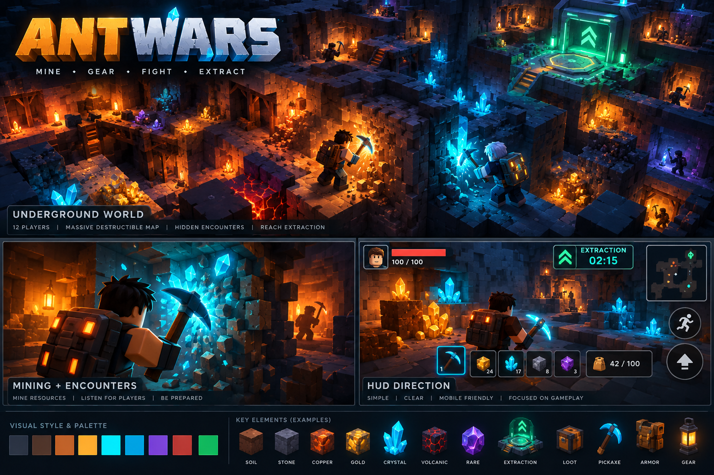
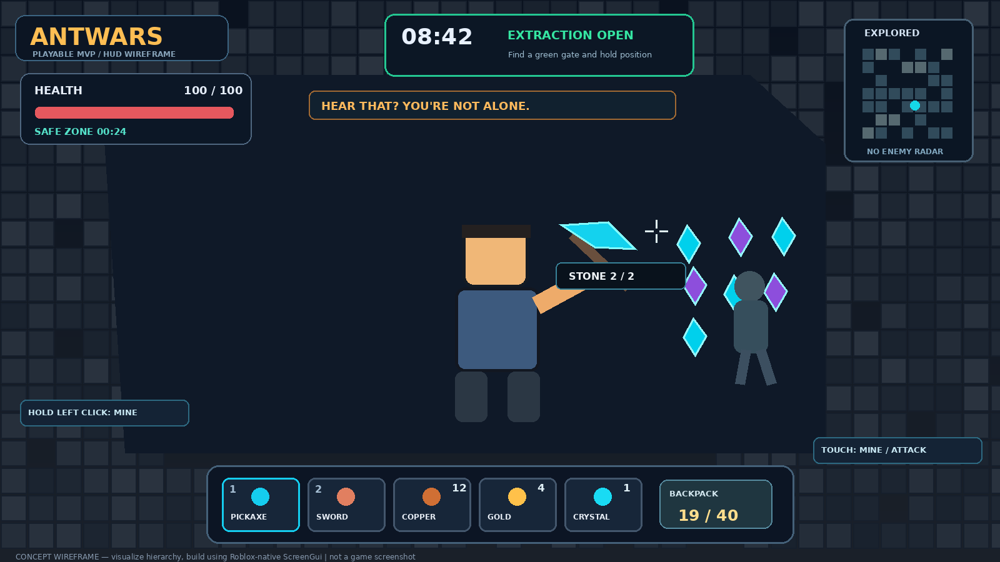
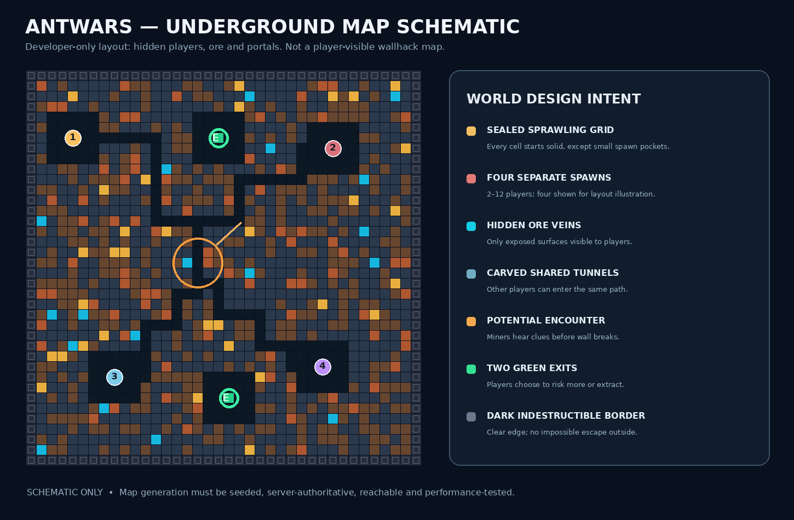
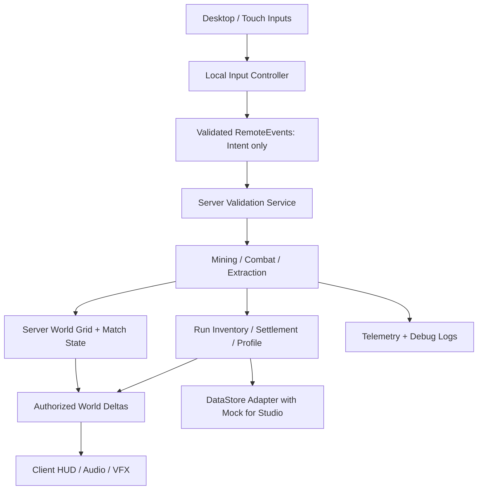

# ANTWARS — ALL-IN-ONE MASTER PROMPT FOR CODEX / CLAUDE CODE

**READ FROM TOP TO BOTTOM AND BUILD IN THE CONNECTED ROBLOX STUDIO.** This complete prompt includes product, visuals, implementation, tests, constraints and next steps. The goal is a tested executable MVP, NOT just text. Respond to the owner in Russian. The original creator requires **one champion per match**. Three original images accompany this file:







Values given below are testable design hypotheses, not measured Roblox market or retention benchmarks. In case of disagreement, prioritize clear user intent and working multiplayer first.


---

# EXECUTION PROMPT

# ANTWARS — MASTER EXECUTION PROMPT FOR CODEX / CLAUDE CODE

> Project: **ANTWARS: BELOW THE SURFACE** (working title). Language for developer communication: **Russian**. In-game copy: concise **English**, stored in one localization/config module for later translation. Engine: **Roblox Studio + Luau**. Date of brief: **12 October 2026**. Stage: **playable pre-alpha vertical slice**, not a finished commercial game.

## YOUR ROLE AND AUTHORITY

You are the hands-on **lead Roblox gameplay engineer + technical game designer + environment/UI prototyper + QA engineer**. **BUILD AND TEST** the game inside the currently open Roblox Studio place using the official Roblox Studio MCP integration, not merely write advice or theoretical scripts. You have access only to the tools actually provided by the connected client; verify which are available before use. You may create well-organized scripts, objects, scenes, UI and tests in a new/safely isolated workspace. Do not publish, purchase assets, spend Robux, enable public access, destroy existing user content, modify unrelated places or install untrusted plugins without explicit approval.

This is a **new product**; where requirements conflict, prioritize: (1) a runnable, secure multiplayer gameplay loop; (2) clear player experience; (3) performance; (4) coherent visual quality; (5) extra mechanics. Do not overengineer phase 1.

**Start by executing these steps, in order:**
1. Confirm MCP connection using available Studio discovery/state tools, list Studio instances if applicable, identify correct open place and current Edit/Play state. If MCP is unavailable, state exactly what is blocked, create/update local project source files when tools allow, and provide a short, specific connection fix; NEVER say you modified Studio unless you actually did.
2. Inspect DataModel / scripts / Workspace and take a baseline screenshot (if tools available). If existing assets are present, do not overwrite them blindly; put new content in clearly named `AntWars_*` containers or make a backup/duplicate for significant edits.
3. Read `docs/ANTWARS_GDD.md`, `docs/TECHNICAL_ARCHITECTURE.md`, `docs/VISUAL_DIRECTION.md`, `docs/BUILD_AND_TEST.md`, `docs/TASKS.md`, and `docs/POST_MVP_PRODUCT_STRATEGY.md` in this package. Use `assets/reference/ANTWARS_CONCEPT_ART.png` and `assets/reference/ANTWARS_HUD_WIREFRAME.png` and `assets/reference/ANTWARS_MAP_SCHEMATIC.png` as VISUAL REFERENCES, not as guaranteed-accurate final UI assets. If only this prompt is present, use the full brief appended in `ANTWARS_MASTER_PROMPT.md`.
4. State a **concise implementation plan** (max 10 bullets) and immediately start building; do not spend the whole answer writing plans. Make reasonable defaults and document assumptions. Ask only for an essential permission/irreversible decision.
5. Deliver a complete **first playable loop** in the open Studio place: spawn in an underground chamber -> mine destructible rock -> gain virtual ore in run backpack -> find crystals/gear -> reach another player via tunnel -> fight -> extract to bank resources -> return to lobby -> start another round. If no second real player is present, simulate the gameplay state in tests, but do not claim real PvP is validated until a 2-client test passes.
6. **Playtest repeatedly**, capture output/errors, fix blocking issues, visually inspect with screenshot(s), and report: created objects/files, working features, tests passed/failed, known limitations, next task. Finish with a playable phase, not a pile of broken scripts.

## PRODUCT VISION / NON-NEGOTIABLE CORE

**Pitch:** 2–12 players enter the same giant mysterious underground labyrinth. Everyone starts in separate sealed chambers and carves tunnels through destructible soil and stone. Hidden ore yields loot; distant pickaxe strikes reveal that somebody else might be on the other side of the wall. The player weighs greed against survival: keep mining for a rare crystal, ambush another player, or escape through an extraction portal and permanently bank the run's discoveries. Short, readable PvP clashes produce surprising emergent stories. The experience is tense and rewarding but **not gruesome, unfair, or unplayable for beginners**.

The game name **ANTWARS** describes ant-like tunnel networks and territorial encounters. **Players are Roblox-style adventurers, not literal ants**. Do not replace concept with ant colonies, insect warfare, generic tycoon, Minecraft clone, tower defense or an endless simulator. The distinctive fantasy is: **“You never know who is behind the next wall.”**

**ORIGINAL USER REQUIREMENT — EXACTLY ONE WINNER:** The founder originally specified that ONE PLAYER wins each round. Preserve that in game rules: extraction is an optional cash-out that forfeits the round championship; the last active non-extracted survivor becomes **CHAMPION** if exactly one remains. If time runs out or everyone extracts/dies, select one champion using a deterministic server-side ranking (PvP defeats → banked+carried ore → survival duration → unique player ID tie-break), clearly explaining that this is a fallback rule. The MVP must display ONE CHAMPION. These are prototype design decisions; keep configurable for future user review.


Core loop:
`LOBBY → PREPARE → SPAWN SEPARATELY → DIG → DISCOVER ORE/GEAR → HEAR OTHER PLAYER → BREAK THROUGH → FIGHT OR EVADE → EXTRACT → BANK LOOT / UPGRADE → REQUEUE`.

MVP principles:
- **Mining is physical and multiplayer:** a block disappears for all players after a server-validated mine action; it reveals a traversable cell/tunnel, not just changes a number on the screen.
- **Discovery is uncertain:** no enemy outlines through solid walls, no full-map enemy radar, no client-replicated secret loot tables.
- **First reward fast:** player understands mining and receives first ore within ~20–40 seconds (design target; verify in tests).
- **First potential encounter:** world design should allow an encounter within ~3–6 minutes with multiple active players (initial design target, not measured market data).
- **Meaningful extraction:** accumulated **run loot** is at risk, but basic equipment and durable account progress are safe.
- **Mobile first:** large buttons, readable HUD, high contrast, usable at small screens.
- **No pay-to-win, paid randomness, wagering, Robux-linked loot risk or real-money rewards in the MVP.**

## INITIAL GAME RULES — CONFIGURABLE HYPOTHESES, NOT VERIFIED METRICS

- Match target: **12** players; **minimum 2** for true PvP matches; solo development/debug mode allowed. Provide config `MinPlayers`, `MaxPlayers`. Match length: **12 minutes**; configurable and visible in HUD.
- Intro/spawn safety: **60 seconds** of PvP protection, clear icon, end-of-protection warning. No ability to exploit protection to deal damage.
- Layout: seed-based underground 3D environment, approximately **48×48×6 logical cells**, **6 studs** each. This is a starting prototype target; reduce if real tests show memory/fps/network problems. Do NOT create one permanently replicated Part per filled voxel. Use sparse/chunked visible geometry (or a measured Terrain solution) with authoritative logical occupancy.
- First version may restrict player-modifiable mining to X/Z and curated vertical access routes while retaining 3D atmosphere; mark additional freeform vertical digging as Phase 2. Never fake it as implemented.
- Stone: ~2 hits; dirt ~1; copper ~3; gold ~4; crystal ~5. Values are illustrative and should live in config, not hard-coded throughout scripts. Use three ore tiers minimum.
- Backpack: **40** run-resource units by default. Mining yields resources only if validated and capacity allows; prompt to extract or discard when full.
- Loot: ore has guaranteed small rewards, scarce crystal clusters, **optional** weapon pickup from physically exposed caches. Do not expose hidden ore in client state before reveal.
- PvP MVP: one reliable melee weapon, health 100, damage with server-side hit/distance/cooldown validation, respawn in lobby on death. No gore, realistic blood, scary body horror. Avoid kill farming at spawn.
- Extraction: place **two distinguishable extraction portals**, unlocked after minute **4**; player must reach one and channel for **6 seconds**. Channel is interrupted by damage, leaving zone, or death. Extracted player banks all carried run resources and returns to lobby/result screen. Portals need obvious green beacon and directional cues, not exact coordinates of enemies.
- Death: keep persistent progression and starter equipment; **40% of unbanked run ore is salvaged** into a small fallback reward, remaining **60% drops as one world loot bag** collectable by others (if this presents fairness/performance problems, make the loss rate configurable). A dead player exits the round; no repeated instant PvP deaths in same match. Loot drop values are whole numbers with explicit rounding rules.
- Match timeout: surviving players who have not extracted get **25% fallback banked ore** and clear explanation; no full rewards. Check this does not encourage AFK farming.
- Persistent currency: **Salvage**, earned from extracted ore conversion and allowed partial fallback. Upgrade pickaxe mining speed/range by small increments but prevent direct combat stat purchases/upgrades in MVP. No trading or user-to-user paid items.
- End-of-round leaderboard: ore extracted, opponents defeated, survival time. Status-based praise, not only richest-player dominance.
- **Single champion condition:** on only one living, active, non-extracted contestant, conclude with that person as sole champion; extraction cashes out resources but forfeits win. On time-up or zero active contestants, apply deterministic scoreboard winner tie-break described above. Do not award multiple champions. If only a solo debug player exists, do not pretend competitive champion victory was earned.

- Tutorial: 3 short contextual prompts: `MINE [rock]`, `LISTEN [distant digging]`, `EXTRACT [green beacon]`.

## STUDIO OBJECTS AND CODE QUALITY

Use **strict-ish typed Luau** (`--!strict` when practical), clear names, small modules, clean task lifecycles, one source of truth per state. Suggested containers:

```
ReplicatedStorage/
  AntWarsShared/
    Config (ModuleScript)
    ItemDefinitions (ModuleScript)
    GridMath (ModuleScript)
    RemoteNames (ModuleScript)
    Types (ModuleScript)
  AntWarsRemotes/
    MineRequest (RemoteEvent)
    CombatRequest (RemoteEvent)
    ExtractionRequest (RemoteEvent)
    ClientState (RemoteEvent)
    WorldDelta (RemoteEvent)
    PlayerFeedback (RemoteEvent)
ServerScriptService/
  AntWarsServer/
    Bootstrap.server.lua
    Services/
      MatchService.lua
      WorldGridService.lua
      MiningService.lua
      InventoryService.lua
      CombatService.lua
      ExtractionService.lua
      PersistenceService.lua
      TelemetryService.lua
      ValidationService.lua
StarterPlayer/StarterPlayerScripts/
  AntWarsClient/
    Bootstrap.client.lua
    Controllers/
      InputController.lua
      MiningController.lua
      CombatController.lua
      CameraController.lua
      HudController.lua
      EffectsController.lua
StarterGui/
  AntWarsHUD (ScreenGui)
Workspace/
  AntWarsWorld/
    GeneratedChunks/
    Lobby/
    ExtractionPoints/
    SpawnChambers/
    AudioZones/
ServerStorage/
  AntWarsServerAssets/
```

The exact folder mapping may differ when connected through MCP and when using Rojo: **prefer working real Studio objects over imaginary file paths**. Never place authoritative combat, mining rewards, inventories, or save logic solely on the client. All RemoteEvent payloads type-checked, distance-checked, cooldown-limited and state-checked on server. Client sends **intent**, not `giveOre=1000`, `dealDamage=9999`, `destroyInstance=...` or arbitrary path. No arbitrary model/asset injection from client messages.

For persistence, use `DataStoreService` with versioned schema, `UpdateAsync` where appropriate, `pcall` error handling, save throttling, autosave/disconnect handling, and Studio mock storage in development to avoid accidentally overwriting live data. **Do not enable live DataStore access without asking.** Lobby/result must still function if persistence is temporarily unavailable.

For performance, profile mobile budgets. The game must not keep 10k+ independent physics/collidable blocks instantiated or replicate full underground terrain state every frame. Implement deterministic world generation, only exposed chunks/faces, pooling or prudent cell visualization, and delta replication. Use `StreamingEnabled` judiciously and test it; don't assume it fixes all voxel costs. Preserve correctness when two players mine the same block almost simultaneously.

## VISUAL ART DIRECTION (REQUIRED, NOT OPTIONAL)

Reference: `assets/reference/ANTWARS_CONCEPT_ART.png`. This is a **mood board** — visual hierarchy matters more than exact fidelity.
- Distinctive blocky/voxel-compatible Roblox stylization; underground stone, compact tunnels, mineral crystals, wooden props, lanterns; **not a generic empty gray baseplate**.
- Colors: almost black navy `#0D1522`, basalt `#293445`, earth `#694330`, copper `#D97837`, warm gold `#FFBD50`, cyan crystal `#11CDEB`, purple epic `#904DE0`, extraction green `#2AD78F`, hazard red `#EB5959`.
- Key screenshot: camera behind blocky miner, cyan pickaxe hits stone wall, blue glowing crystal exposed, distant **ambiguous silhouette** at a newly opened tunnel, warm lantern behind; green escape beacon glimpsed far away.
- Visual clarity: ore identifiable by shape + color, readable even without color vision. Cracks/sparks and progress indication during mining. Combat sparks and satisfying but restrained hit feedback. No gore.
- HUD on desktop: health upper-left, timer + extraction state top-center, compact exploration-only map upper-right (no wallhack), resource inventory/hotbar bottom, mining crosshair center, contextual prompt near crosshair, events ticker. Mobile: left thumb movement stick, right `MINE`, `ATTACK`, `INTERACT` large tap areas.
- Ambient sounds: digging through rock, low underground rumble, crystal shimmer, muffled player mining sound whose volume/spatialization can build suspense. Audio must not incorrectly reveal precise coordinates through solid walls; balance gameplay cues in playtests.
- Lighting: cool ambient in caves, warm orange practical lights, colored ore accents, green extraction. Must stay readable on a mobile device at default brightness. Use Roblox-native primitives/materials/placeholders if external assets are unavailable.

## IMPLEMENTATION MILESTONES — EXECUTE, VERIFY, THEN ADVANCE

**M0 — Connect & survey:** Verify Studio session, empty/new/safe target, prepare folders, config, remote contracts, reference screenshots; produce technical notes.

**M1 — First playable mining:** Build atmospheric sealed cave, character spawn, mouse/touch mine action, server-authoritative block removal, ore rewards, HUD changes, sounds/particles, camera collision; works in single-client Studio Play and zero errors.

**M2 — Multiplayer encounters:** Two real test clients, separated spawns, shared persistent tunnel destruction within match, player footsteps/digging audible through nearby rock, short melee combat with server validation, death/reward handling. Confirm both clients see identical mined holes and no double rewards.

**M3 — Actual extract loop:** Match timer, green extract portal and channel, banked resource conversion, results screen, requeue, safe fallback when dead or time expires. Save test progress behind environment-safe persistence abstraction.

**M4 — Polish/prove:** Mobile input, optimized chunk streaming, encounter pacing/telemetry, screenshot reviews, 2–4-player tests, critical exploit tests, documented performance. Only after M3/M4 propose ranked modes, equipment rarity, clans, advanced vertical digging and monetization.

**Acceptance criteria** (do NOT claim passed without evidence):
1. On launch the player sees a compelling underground scene, not baseplate and no red errors.
2. A click/tap against diggable rock gives immediate feedback; server checks range/tool/cooldown and creates a persistent visible path for all clients.
3. Ore increments exactly once, inventories cannot exceed capacity, invalid remote arguments cause no state change.
4. Two clients can meet via player-made tunnels and fight; server decides damage, target and cooldown.
5. Extracting banks correct amount and clears temporary carried loot; death applies configured loss and persists appropriate fallback.
6. Leaving and rejoining does not duplicate rewards and does not corrupt profile data.
7. Basic UX works on mobile emulator; controls don't obstruct gameplay.
8. AI agent has run actual Play mode, retrieved console output, fixed errors, and captured before/after screenshots when tools permit.

## COMMUNICATION AND DONE DEFINITION

As you work, give short checkpoint reports in **Russian** after milestones. Report actual measured/observed outcomes rather than fabricated test coverage or FPS. If a feature wasn't built, mark it `NOT IMPLEMENTED`. If a multiplayer test wasn't possible, mark it `NOT VERIFIED` and explain the exact workaround. If blocked by permissions, ask one specific question and otherwise continue on unblocked work.

At the end, provide:
- `WHAT WAS BUILT` (specific Studio paths / source files)
- `PLAYTEST RESULTS` (mode, clients, date, observed behavior, output/errors)
- `SECURITY / PERFORMANCE` (which checks exist, bottlenecks)
- `VISUAL QA` (screenshots or tool-produced observations)
- `KNOWN LIMITATIONS`
- `NEXT IMPLEMENTATION STEP` (one clear next vertical slice)

**Your first response should be brief and operational: identify the connected Studio place, state the first 3 actions, then immediately inspect/build the project. Do not merely reprint the design document.**


---

# GAME DESIGN

# ANTWARS — GAME DESIGN DOCUMENT (PRE-ALPHA v0.1)

**Working title:** ANTWARS: BELOW THE SURFACE  
**Genre:** Multiplayer underground mining + unpredictable PvP + light extraction + persistent meta-progression  
**Target:** Roblox on mobile and desktop first.  
**Status:** A design hypothesis to validate with actual player tests, **not** a researched/verified retention forecast.  
**One-liner:** Mine blindly through a shared underground world. Every strike may bring treasure — or break through into another player's tunnel. Take your haul to extraction before you lose it.

**FOUNDER CONSTRAINT: ONE ROUND, ONE CHAMPION.** Extraction is an optional early cash-out, not an automatic win. If only one active, living, non-extracted player remains, that player becomes champion (unless a debug solo match). At time limit / no active player, use deterministic server ranking: PvP defeats, then total banked+carried ore, then time survived, then unique player ID. Exactly one champion is shown, and ties cannot create two. All thresholds and scoring are testable, configurable **design hypotheses**; a simpler pure last-man-standing mode is a valid post-test alternative.


## 1. Pillars, promise, boundaries

### 1.1 Three pillars
1. **Mystery behind every block:** Mining changes physical navigable space. Hidden ore, vaults, and players create tension and surprise. Never show all information or instantly point players to combat.
2. **Greed versus safety:** A player decides when to leave with loot. Risk is meaningful but not punishing enough to erase the first day's progress.
3. **Player-made stories:** Shared tunnels, audible digging and short PvP encounters create spontaneous situations that can be described in one exciting sentence.

### 1.2 The emotional journey
- **Curiosity:** “What is behind this wall?”
- **Progress:** “My tools are better; I see a new vein.”
- **Unease:** “Wait, I can hear someone digging.”
- **Panic or bravery:** “The wall broke open and there is a real player!”
- **Relief:** “I barely got out with my crystals.”
- **Desire to retry:** “Next run, I will take a better route.”

### 1.3 What this game is not
Not a passive auto-clicker; not a mining tycoon; not an open-world sandbox with no win condition; not a random loot-gambling casino; not a game whose main progression requires paying Robux; not a pure competitive arena shooter; not real insects/anthill management. The term AntWars refers metaphorically to underground tunnel competition.

## 2. Gameplay loop at three time scales

**Moment-to-moment, ~2–15 s:** look at block → mine it (hit feedback) → reveal adjacent block/small pocket → gain resource or information → move forward / change direction. Listen for clues.

**One run, target ~8–12 min:** spawn with safe starter kit → uncover low-tier ore → choose riskier paths → get optional cache / conflict with player → decide whether to extract → bank resources or salvage on death → result/quick requeue.

**Across sessions:** bank Salvage currency → upgrade basic mining efficiency/carry capacity with diminishing returns → unlock cosmetic helmets/lantern colors/tunnel banners → discover varied biome conditions (later) → pursue account milestones/season challenges (later).

### 2.1 Basic round states
### 2.0A Champion and voluntary escape rules

- **Championship is the competition:** One server-announced champion per genuine multiplayer round. Being the last living **active** contestant earns the win; players who extracted earlier keep their loot but exit the championship. Players who die are eliminated.
- If all players leave active status by death or evacuation, or if timer ends with multiple survivors, winner determined by **PvP defeated count**, then **total ore banked+carried**, then **survival time**, then **unique ID**. This is a fallback scoring rule, not claimed to reflect player demand. Always present reason `LAST MINER STANDING` or `POINTS TIEBREAK` on results.
- To avoid an early auto-win while everyone extracts, consider minimum round active time and appropriate extraction gate locations, but do not turn winning into random chance.
- In solo debug only, show `SIMULATION COMPLETE`, not a false competitive victory.
- Store champion decision as single immutable per-run result to avoid two players winning due to race conditions.


`WAITING_FOR_PLAYERS` → `COUNTDOWN` → `GENERATING` → `SPAWNING` → `ACTIVE` → `ENDING` → `RESULTS` → `RESET`.
- Real PvP requires at least two human clients. For solo Editor tests, allow a **DEV_DEBUG_SOLO** flag that launches round without inflating the player count or pretending PvP happened.
- Players joining mid-round: join spectator-safe lobby and can queue for next round. MVP does not insert new players inside an active map.
- Match is local to a server for MVP; do not build cross-server matchmaking or many places yet.
- When the only surviving player leaves early, allow safe conclusion rather than waiting out timer.
- Create transparent status handling when no players or generation fails.

## 3. Underground world

### 3.1 Prototype spatial model
- Work with a logical grid, initially **48×48×6 cells × 6 studs/cell**, reducing dimensions if performance requires. The logical grid is a **server-side occupancy/resource model**, not a requirement to create ~14k physical Parts.
- Map has an outer indestructible shell. 2–12 isolated initial pockets, spaced to avoid near-instant combat. Main navigable caverns should feel interconnected only after mining.
- Later add biome bands, randomized chambers, dangerous depths and distinct minerals.
- **First playable restriction:** support clear walkable horizontal digging, plus curated vertical connections (shafts with stairs/ramps). Do not expose free vertical mining unless movement, falling, stuck detection and server validation are solved.
- Random seed per round; record seed in console/telemetry for reproducibility.

### 3.2 Traversability and map generation
- Spawn rooms are at least 2 cells high and have a diggable exit; safe spawn areas cannot be destroyed from outside immediately.
- At least two extraction points are reachable by some route from every spawn (pathfinding on expected diggable grid, not only initial walkable space). This can mean a player digs a reasonable distance; no “permanently trapped spawn”.
- Ensure enough baseline stone corridors/valuable ore near early spawns, but don't reveal player positions through the map.
- Indestructible boundary blocks are visually distinct (metal reinforcement/dark obsidian) with clear “UNBREAKABLE” feedback.
- Block removal creates immediate tunnel traversal; neighboring terrain visuals and collisions update efficiently.
- Spawn protected no-PvP zone lasts 60 seconds; do not encourage players to camp entrance after it ends.

### 3.3 Biomes (visual now, full gameplay later)
- **Dust Layer:** orange-brown dirt, copper; safest and brightest.
- **Slate Layer:** blue-gray stone, gold; more mysterious.
- **Crystal Layer:** navy black with luminous cyan/purple veins; highest loot/risk.
For MVP, use these as color/material treatments and limited variations, not 3 separate sprawling fully simulated maps.

## 4. Mining and discovery

### 4.1 Player inputs
Desktop: aim with mouse crosshair, left-click/hold mines; `1` pickaxe, `2` melee, `E` interact/extract, `Shift` sprint if appropriate. Mobile: right-hand `MINE` hold button or tap-on-target (choose and test), `ATTACK`, `INTERACT`, visual reticle; Roblox thumbstick remains unobstructed. No key is required to mine the very first block if a sensible default tool is equipped.

### 4.2 Block definitions (prototype values)

| Block type | Health/hits | Reward | Visual cue | Purpose |
|---|---:|---|---|---|
| Dirt | 1 | 0–1 dust | Brown smooth face | Fast progress / open tunnels |
| Stone | 2 | 1 stone | Blue-grey cracks | Baseline mine action |
| Copper Ore | 3 | 2–3 copper | Copper specks | First meaningful discovery |
| Gold Ore | 4 | 3–5 gold | Angular yellow flecks | Scarcity / mid-run reward |
| Crystal Ore | 5 | 1–2 crystals | Cyan luminescence | High stakes / highlight moment |
| Reinforced Border | ∞ | 0 | Dark steel + warning symbol | World boundary, not mineable |

Numbers are tuning defaults. Rewards derive from server-side configuration and seed; the client may render effects but may not choose ore, rarity or final yield.

### 4.3 Ore reveal
Hidden ore distribution must be deterministic by round seed on the server. Avoid instancing and replicating every hidden ore block in advance — clients should receive **visible** surface material only, not future loot contents. A struck visible block reveals what was behind it based on deterministic server data. Hide contents until reveal. Use local particles/glow for already exposed rare veins.

### 4.4 Tool upgrades and pace
A starter pickaxe is permanent. Some persistent Salvage buys 3 early grades of mining speed or carry capacity; price grows while advantage stays bounded. Combat skill, tactical choices and awareness should outweigh account progression in PvP. For MVP, tool progression may be showcased in lobby with only one purchase and one obvious improvement.

### 4.5 Mining feedback
Impact screen shake (subtle), sparks, dust burst, crack decal/progress bar, tiny loot popup, mineral sound, short celebratory accent on crystals. Effects must be toggleable/reduced on mobile. Immediate client visual prediction allowed, but state only changes on confirmed server result; reconcile promptly after denial.

## 5. Encounters and PvP

### 5.1 Unique selling point
Two mining players are separated by a thin wall. Their pickaxe sounds travel imperfectly. Neither sees the other. One more swing removes the block. One player can flee, talk through approved Roblox chat, or fight. This must be a genuinely possible situation in the real multiplayer world, not a pre-recorded animation.

### 5.2 Noise, information, counterplay
- Nearby mining emits directional/muffled audio within a limited radius; audio “clues” rather than perfect position and distance.
- Later: dust falling off ceilings, cracks, footprints, scanners with cooldown. No wallhack minimap or always-on arrows pointing at enemies in MVP.
- In PvP use local hit indication and damage amount optional, health displayed only when encounter visible (if enabled).

### 5.3 Combat prototype
- All players 100 HP. One sword/short pick; server checks equipped state, hit range, line of sight when appropriate, angle, cooldown, target live state, phase not protected, friendly/self cases.
- Proposed default: 20–25 damage per validated swing, ~0.8 s cooldown; test responsiveness and time-to-kill. Values configurable, not backed by platform data.
- No automatic aim-lock through walls. Avoid stun-lock; give ~0.3–0.5 s damage feedback without disabling control.
- Cosmetic hit sparks only: platform-appropriate fantasy fighting; no gore, realistic wounds or gambling/death-for-Robux.
- Basic anti-teaming considerations: solo mode first; if teaming causes issues later consider squad queue, but don't add complex anti-team detection at MVP.

### 5.4 Death penalty
Starter equipment and durable profile remain. Suggested default: **40% of unbanked ore salvaged** as fallback, **60% dropped as a single interactable bag**; explicit integer rounding and anti-duplication. Alternative configurable `RunLootLossRate` if UX testing shows frustration. Dead player goes to lobby/result and can join future round. Don't destroy all rewards for new players without evidence.

## 6. Extraction and bank

### 6.1 Mechanics
- 2 green escape points on map, distinguishable by shape, beacon, color and audio; location revealed as reachable **directional objective**, not wallhacks or enemy coordinates.
- Extraction unlocks after **4 min**; HUD shows countdown to unlock. Channel lasts **6 s**, requires presence in trigger region, valid living player, and no incoming damage or movement out of range during channel.
- When successful: transfer current **run ore** to durable **Salvage** (conversion table/config), increment `ExtractedRuns`, give result recap and teleport character to safe lobby. No duplicated rewards on repeated request/reconnect. Extracted player no longer vulnerable in match.
- At round time expiry, apply **25% fallback** on unbanked resources for surviving unextracted player (separate from death salvage; ensure exactly one settlement event).
- If loot bag collected by other player, update inventory with capacity limits and mark bag consumed atomically.

### 6.2 Result UX
Result shows `Ore Found`, `Salvage Banked`, `Players Defeated`, `Time Underground`, `Biggest Find`; choice `UPGRADE PICKAXE` or `PLAY AGAIN`. If no persistence in Studio tests, tell developer via debug note, not player via ugly stack trace.

## 7. Meta-progression & economy

### 7.1 Two inventories
**Run inventory:** ephemeral; ore, picked-up cache rewards and salvageable items, cleared after death/extraction/timeout.  
**Profile:** durable; `schemaVersion`, Salvage, PickaxeTier, CosmeticUnlocks, LifetimeStats, TutorialState, optionally Settings. Never treat a client's in-memory GUI count as the source of truth.

### 7.2 Progression examples (test values)
- Grade 1 starter pick: 1.0× mine speed.
- Grade 2: 1.15×, cost 30 Salvage.
- Grade 3: 1.3×, cost 100 Salvage.
- Initial backpack 40 units; bigger capacity may be a later upgrade.
No rebirth/prestige, idle generators, pets, loot boxes or massive currency inflation in MVP.

### 7.3 Economic integrity
- Mining reward never awarded twice for same cell.
- Multiple interactions on one bag/extraction must settle once, including fast repeat requests.
- Each unique run has ID; reward transactions idempotent by `runId` / event ID where appropriate.
- Pickaxe price checked on server; negative values/non-finite numbers rejected.
- Avoid account power creep destroying fair encounters. Distinguish mining quality-of-life from combat advantage.

## 8. UX and onboarding

### First 60 seconds (hypothesis)
0–5 s: appear in sheltered grotto, glowing ore immediately visible. One strong callout: **“DIG TO ESCAPE”**.
5–20 s: aim/punch/mine first blocks; sensory feedback; first ore popup.
20–40 s: first tool/item reward; visible `BACKPACK: 3/40`.
40–60 s: subtle distant mining SFX and copy: **“HEAR THAT? YOU'RE NOT ALONE.”** PvP safety timer ending indicator. No six-page tutorial.

### Minutes 1–4
Broaden route choices and resource quality. Player discovers early tunnels and recognizes a high-value ore vein. Several possible directions, not a single scripted hallway.

### Minutes 4–8
Extraction opens and creates strategic choice; riskier ore zones become attractive; a few PvP encounters possible. Never enforce that every player fights.

### Minutes 8–12
Extraction threat and time pressure intensify; tell players what will happen if time runs out. Successful bank should feel rewarding even on modest first run.

### UI rules
- Never flood UI with floating text. Use 2–3 clear live priorities.
- Large high-contrast interactions with legible labels and icons; no small text on mobile.
- All countdowns and inventory numbers consistent with server state.
- Use readable non-flashing cues as alternative to pure sound/color.
- Ensure HUD doesn't obscure avatar or aim area.

## 9. Future features — explicitly OUT OF MVP

1. Multiple named biomes with bosses/hazards.
2. Dynamic small caves, deep vertical mining, elevators.
3. Procedural PvE creatures.
4. Duos/squads, factions, clan burrows.
5. Trading and marketplace.
6. Ranked seasons/competitive ladders.
7. Rare weapon modifiers and advanced gear.
8. Cosmetic monetization, passes and non-competitive customization.
9. Cross-server matchmaking and reserved server flow.
10. Anti-teaming/wallhack protections beyond baseline visibility and validation.
11. Replay / clip-friendly spectator camera.

These are future hypotheses, not instructions to build immediately. After MVP tests, prioritize based on retention/fairness/technical results.

## 10. Instrumentation and tests

Essential events (no personally sensitive freeform payloads):
`game_join`, `tutorial_first_mine`, `mine_attempt`, `mine_confirmed`, `ore_collected`, `rare_ore_discovered`, `player_heard_nearby` [if reliably detected], `encounter_started` [precise definition required], `pvp_damage`, `player_died`, `extraction_started`, `extraction_interrupted`, `extraction_completed`, `run_ended`, `upgrade_purchased`, `requeue_clicked`, `client_error`.

Every event should include event version, session/run ID, phase timestamp, relevant ore/tool tier, but no sensitive user information or excessive high-frequency logs. Define `encounter_started` as **a server-observable condition**, e.g. two living players with line of sight and within 40 studs for at least 0.5 s; don't pretend it measures a player's psychology. Throttle mining telemetry aggregation.

MVP design test questions:
- Can a first-time player mine without explanation?
- Do most test players see another human in a typical multiplayer run?
- Do players understand why they lost part of their loot on death?
- Can players reach a valid extraction from every spawn with a finite amount of mining?
- Is the PvP fight decided by awareness/skill rather than mining account level?
- Does client FPS and memory remain acceptable on low/mid-tier mobile test conditions? Measure, don't invent.
- Does a player want to start another run **after** extracting or dying?

## 11. Prototype decision log

All numeric settings are placeholders until measured in Studio and playtested with actual people. Agent must maintain a `TUNING_NOTES.md` or config changelog listing the original value, change, reason, test date and observations. Highlight trade-offs:
- Time-to-first-ore vs discovery surprise.
- Dense tunnels vs meaningful isolation.
- High mining speed vs world running out of blocks.
- Loot on death vs beginner frustration.
- Player density vs unfair spawn ambush.
- Visual darkness vs mobile visibility.


---

# TECHNICAL ARCHITECTURE

# ANTWARS — TECHNICAL ARCHITECTURE FOR ROBLOX STUDIO

## 1. Technical goal and constraints

Build a **real, server-authoritative, multiplayer** playable vertical slice in Roblox Studio. The spatial data should support deterministic resource placement, cooperative/competitive digging, discovery and collision, while remaining playable on mobile. Protect live data and user-authored Studio assets. If a preferred technique proves impractical, document the simpler measured replacement instead of generating thousands of laggy Parts.

**Official references (recheck when implementing):**
- Studio MCP: https://create.roblox.com/docs/studio/mcp
- Roblox scripting remotes: https://create.roblox.com/docs/scripting/events/remote
- Client-server security: https://create.roblox.com/docs/scripting/security/client-server-boundary
- Data stores: https://create.roblox.com/docs/cloud-services/data-stores
- Terrain API: https://create.roblox.com/docs/reference/engine/classes/Terrain
- Testing modes: https://create.roblox.com/docs/studio/testing-modes
- `StudioTestService`: https://create.roblox.com/docs/reference/engine/classes/StudioTestService
- Performance optimization: https://create.roblox.com/docs/performance-optimization

Do not assume an undocumented engine method exists. Consult Studio MCP `http_get` / official docs if unsure.

## 2. Architectural layers



**Server owns:** match phase, map seed, hidden ore type, mined flags, rewards, run inventory, stamina/health decisions, tool stats, authoritative damage, extraction validity, settlement, durable save state.

**Client owns only:** local input, camera, HUD rendering, optional non-authoritative predicted mine animation, local effects, menu state. Client cannot award itself loot or choose enemy damage.

## 3. Modules and responsibilities

### Shared
- `Config`: min/max players, round timing, grid size, hit cooldowns, resource tables, ore rarity weights, extraction balance, visuals and debug flags; one canonical source.
- `Types`: typed tables for `Cell`, `PlayerRun`, `Profile`, `Round`, `MiningResult`.
- `GridMath`: grid index/world position conversions; coordinate bounds, neighbor lookup, deterministic hashing. Unit-tested.
- `ItemDefinitions`: ore/item rarity, yield, tool properties, backpack unit volume, UI display names/colors.
- `RemoteNames`: names/contract version shared with clients. No dynamic network path from client.

### Server
- `Bootstrap`: ensures containers/remotes exist; constructs services in dependency order; cleans up after hot reload where possible; logs build version.
- `MatchService`: lobby, countdown, match lifecycle, alive/extracted/dead player states, end-of-round, reward settlement once, queue re-entry.
  **Exactly-one-champion invariant:** Last active living non-extracted player wins unless solo debug; on timeout/no active contestants rank by PvP defeats, then banked+carried ore, then survival time, then unique user ID. Champion result is computed once on server and sent to every client. Extracted players bank loot but forfeit championship.

- `WorldGridService`: seeded hidden material map, diggable occupied states, spawn pockets, traversable and protected cells, rendering or Terrain mutations, broadcast world deltas.
- `MiningService`: tool equipped, per-player dig rate, camera/raycast/target validation, cell health, atomic cell destruction, ore reward and inventory capacity.
- `InventoryService`: runs and durable inventory, only server modifications, capacity, loot bag claims, overflow feedback.
- `CombatService`: attack request, server verification of proximity and target, damage, death callback, death bag and salvage settlement.
- `ExtractionService`: valid proximity, extraction unlocking, channel timers, interrupt conditions, successful run settlement, prevents repeated claims.
- `PersistenceService`: versioned DataStore schema, mock fallback, retry/error boundaries, atomic updates, no studio-to-live access by default.
- `ValidationService`: reusable type checks, position bounds, cooldown/rate limits, non-finite inputs, state/ownership checks.
- `TelemetryService`: events throttled/sampled where needed, developer/debug logs, in-memory counters if analytics not enabled.

### Client
- `InputController`: desktop, touch and optional gamepad binds using Roblox-supported input APIs.
- `MiningController`: selects target, draws mining reticle/progress/VFX, sends intent and reconciles confirmed result.
- `CombatController`: input and non-authoritative swing visual, waits for authoritative hit feedback.
- `HudController`: text/icons/bars, responsive sizing, hints and result states, reacts to server snapshots/deltas.
- `EffectsController`: pooled particles/sound, screen feedback limits, accessible settings.
- `CameraController`: shoulder 3rd-person default with anti-clipping when tunneling, gentle optional first-person later. Don't force motion sickness.

## 4. World representation and renderer choice

### 4.1 Logical voxel representation
Use a server-owned **logical cell map** keyed by `(x,y,z)` and `roundSeed`. For the prototype, size about `48 x 48 x 6`, `cellSize = 6` studs; horizontal X/Z tunnels are first-class and vertical routes initially curated. Cell contains:

```
Cell = {
  materialId: numeric_enum,
  hp: nonnegative_number,
  solid: boolean,
  mineable: boolean,
  protected: boolean,
  revealed: boolean, -- server reveal/exposure state
  dropSeed: integer, -- or lookup derivation from roundSeed + coordinate
  generationVersion: integer
}
```

Store data compactly, not one Roblox Instance per cell. A `BitBuffer`/packed byte array is optional if supported, but do not invent unsupported APIs. Assign seed to server at round start and record for reproducible bug reports.

### 4.2 Candidate rendering approaches, in preference order
**A. Chunked block faces / sparse physics** (preferred if implemented correctly): generate solid geometry only for exposed surfaces (or merge contiguous adjacent faces), update relevant chunk when a cell is broken. Use capped per-frame chunk updates, reuse materials, preallocate/pool where sensible. Make walkable space and barrier collisions consistent.

**B. Roblox Terrain**: for a coarse “diggable earth” prototype, use `Terrain:FillBlock`/supported voxel APIs and remove cells with `Enum.Material.Air`. Terrain is 4-stud voxels, so if choosing Terrain, align logical cell resolution and conversion appropriately; benchmark repeated mutation and network behavior, do not assume Terrain or Part approach is always superior. Terrain is useful for natural caves but resource blocks still need independent hidden server map.

**C. Narrow proof-of-concept with limited visible cells**: acceptable fallback if A/B cannot be completed safely in the current session. Must still be a real traversable destructible tunnel with 2 clients in a bounded test world, not just cosmetic particles.

**DO NOT:** create a permanent individual collidable BasePart for every solid logical cell, replicate every secret ore piece, destroy entire map/rebuild all Parts on every dig, use thousands of unanchored physics blocks, or blindly stream hidden loot values to all clients.

### 4.3 Exposed-face and secret loot rules
For each mined cell:
1. Validate round active and requested coordinates within bounds and adjacent to reachable face.
2. Atomically decrement its HP / transition solid=false only once.
3. Create immediate clearance for character/physics where mined cell was.
4. Update visible geometry only in affected chunk and adjacent boundary chunks.
5. Send essential small deltas to relevant clients (coordinate, exposed visible material, destruction animation), never entire underlying hidden ore table.
6. Credit resource exactly once, based on server map, if appropriate.
7. Allow two competing requests without two rewards, two drop bags or inconsistent tunnel state.

The biggest risk is implementing “anti-Xray” superficially: even if ore is not visible, replicating all hidden ore properties into the client allows exploiters to inspect them. Only client-visible, discovered material should be sent.

### 4.4 Map generation specifics
- Seeded PRNG with stable hash per `(seed, x, y, z)` for material distribution; use configurable tier weights by band. Seed and algorithm version recorded.
- Outer two or more cells reinforced/indestructible.
- Safe spawn pockets carved before final geometry generation. Ensure first diggable wall appears nearby.
- Select two safe extraction chambers and verify their reachability under diggable rules. Reachability can be estimated with grid breadth-first search treating mineable cells as diggable-cost edges; prohibit impossible solid/boundary.
- Add limited prefabricated tunnel openings and occasional niches without pre-revealing opponents.
- Initial ore near spawn should ensure reward without guaranteeing rare finds. Rare ore by seeded probability, never loot when mining a protected border.
- Chunk rendering updates must be bounded: e.g. queue dirty chunks and process a maximum per frame with enough responsiveness to avoid phantom collision. Tune measured values.

## 5. Mining network and server contract

### `MineRequest` client → server
Payload example `{ v=1, cell={x=INTEGER,y=INTEGER,z=INTEGER}, toolId="StarterPick" }`. The client should NOT send `oreType`, `dropAmount`, `toolDamage`, target Instance path or a ready-made reward.

Server validation checklist:
1. Payload table/schema known, no unknown huge nested payloads.
2. Coordinates are finite numbers and integers within bounds.
3. Player exists, alive, within active round and not extracting/dead.
4. Equipped item is known and owned/authorized.
5. Cell is solid, mineable, not protected and adjacent to a currently valid reachable surface. Validate actual world distance (e.g. 14 studs) and unobstructed ray or voxel adjacency.
6. Per-player click/hold rate respects tool stats. Bound request frequency before expensive operations.
7. Reduce HP using server-defined pickaxe strength; atomically finish cell; if two requests race, only one finishes cell.
8. Award loot only once if capacity permits, otherwise explicit overflow handling.
9. Emit result/delta + visual feedback; no hidden info leakage.

### `MineResult` server → client
Success/denial code, `cell`, `hpRemaining`, `destroyed`, summarized awarded item/qty if player has right to see, `serverTime` optional. Failure should not leak precise hidden ore.

### Input smoothing
For hold-to-mine, client sends bounded requests. Agent may implement local anticipation crack animation, but server remains authoritative; UI must reconcile denied requests. Anti-macro measures should focus on rate limits, not impossible “perfect detection.”

## 6. Combat network and server contract

### `CombatRequest` client → server
Payload intent: attack sequence ID and (optional) aim direction vector or selected target within range, **never** damage amount. Rate-limit and validate schema.

Server validation:
- round ACTIVE, both players alive, PvP protection expired, legitimate equipped melee tool;
- attacker cooldown by authoritative clock, not client's timestamp;
- origin/target distance, server-known character positions, sensible facing/LOS; hitboxes should not allow hit through solid cell walls;
- cap single hit damage and disallow duplicate sequence replay;
- apply damage once; on death transition player to DEAD once, invoke inventory loss / bag spawn settlement exactly once.

**Caveat:** Roblox character movement uses platform networking with client ownership by default in many experiences. Do not promise absolute cheat elimination; validate plausible positions and interactions on server, and check current supported server-authority options in official docs before changing movement replication architecture.

## 7. Extraction state machine

`LOCKED` → `AVAILABLE` → `CHANNELING` → either `INTERRUPTED` or `COMPLETE`.

Required authoritative checks: phase, player alive/present, unlock time reached, entrance proximity, channel duration elapsed, uninterrupted status, no duplicate transaction. Client UI displays hold/progress but cannot commit extraction. Server issues a one-time result with converted inventory, stats and lobby routing. Track per-player `settledRunId` to prevent double-credit if a player dies while channeling or spams the network.

## 8. Loot bags / death and idempotency

- On confirmed death calculate integer quantities from unbanked loot. Suggested: `salvage = floor(amount*0.40)`, `drop = amount-salvage` by item; never duplicate/negate totals.
- Spawn at most one server-controlled bag per death. Ownership of claim is server-defined (any survivor, configurable) with time-to-live to avoid clutter.
- Claim via `ProximityPrompt` or validated request; require real range and atomically set `claimed=true` before adding items.
- If inventory full, either partial transfer or no claim with clear feedback; don't discard an entire rare bag unexpectedly.
- Client must not decide claim amount or change bag contents.
- End-of-round settlement is a separate idempotent operation; store `roundId`/status and clear run inventory once.

## 9. Persistence plan

Use `DataStoreService` for durable values only. Studio prototype defaults to an in-memory mocked store, with **documented toggle** for dedicated unpublished/private test universe. Do NOT turn on API Services against production data without permission.

Example schema:

```
Profile = {
  schemaVersion = 1,
  salvage = 0,
  pickaxeTier = 1,
  backpackTier = 1,
  cosmetics = {},
  lifetime = { runs=0, extracted=0, ore=0, defeats=0 },
  tutorial = { firstMine=false, firstExtract=false },
  lastUpdated = 0,
}
```

Recommended:
- Default/migration functions for unknown/missing fields.
- Server-side update of currency and upgrades with careful conflict handling.
- `UpdateAsync` where atomicity matters, `pcall`, retries with capped exponential backoff for transient errors, throttle and avoid writes on every mined block.
- Join/leave and autosave; gracefully handle shutdown via `BindToClose` where suitable.
- Profile-session locking strategy if persistence grows; for MVP at least avoid concurrent writes/clobbering.
- No profile corruption or free infinite currency if saves fail. Pending rewards may need explicit safe fallback; do not invent a guarantee of durability during outage.

## 10. UI rendering and responsiveness

Implement Studio-native `ScreenGui`/Frames/TextLabels/ImageLabels/Buttons with scale-based sizing, constraints, safe areas and anchor points; canvas group/UIScale if supported. Avoid relying on nonexistent uploaded GUI images. Native placeholders with icons/text/colors are acceptable. Prefer Gotham or current available Roblox UI font. Game text is English with localization keys.

HUD state should be driven by server snapshots/deltas (`ClientState`) with client-only ephemeral cosmetics (crosshair animation). Camera zoom/intersection must permit hitting blocks in narrow tunnels. On mobile verify 16:9 and tall phone resolutions and UI does not cover actions.

## 11. Audio, FX, lighting performance

- Native particle emitter bursts and brief highlights on verified hits, not hundreds of persistent emitters.
- Audio sound groups, 3D spatial positioning for remote digging, attenuation radius and muffling approximated without overpromising physically accurate wall occlusion.
- Limit simultaneous mining impacts and particles; pool where practical.
- Use material color/shape and SurfaceAppearance/decals judiciously; no unauthorized copyrighted assets.
- Exposure/ambient: dark but readable; green extraction must visually pop from ore; red PvP feedback distinct from copper orange.

## 12. Testing matrix

### Unit-like tests (where a test runner is available)
- GridMath: `cellToWorld` inverse, negative/infinite values rejected, out-of-bounds handling.
- Generation: same seed yields same ore and map; opposite seeds plausibly differ; valid spawn cells; extraction reachable.
- Economy: default/upgrade, integer conversion, no negative wallet, backpack cap, round loss totals conserved.
- Idempotency: concurrent mining same cell → exactly one resource award; repeated bag claim → once; repeated extract → once.

### Studio tests
- Solo smoke: spawn, mine 3 blocks, ore UI correct, extraction timer, bank, requeue.
- Two-client Studio multiplayer: different pockets; digging synced; neither sees hidden ore or opponents through walls via authored UI; meet; fight; casualty; loot bag; extraction.
- Four-client: simultaneous mining, rapid join/leave, one disconnect while extracting, inventory full, death at exact expiry.
- Mobile emulator: touch mine/attack/interact and camera; HUD safe area/readability.
- Security negative tests: forged ore qty, out-of-range coordinates, invalid types, spam, long tables, repeated extraction, attacking through wall, out-of-phase operations.
- Performance: measure average/worst observed FPS, server Script Activity, instance count, peak memory, time per mining mutation; record real values or `NOT MEASURED`.
- MCP test tools: use available `get_studio_state`, `start_stop_play`, `get_console_output`, `screen_capture`, subagent playtest (if present). Note MCP single-play may not validate multiplayer: use Studio multi-client Testing Modes or `StudioTestService` where supported, and mark unverified if unavailable.

## 13. Common failure conditions and specific remediation

| Failure | Likely cause | Fix direction |
|---|---|---|
| Only particles when mining | World collision not modified | Mutate authoritative cell and relevant colliders |
| Dig seen by one player only | Client-local world changes | Server replicates verified world delta |
| Ore duplicated | Race condition on cell or bag | Atomic claimed/mined flag before reward |
| Client sees all rare blocks | Hidden map replicated | Server-only material seed, reveal only exposed surfaces |
| Game lags with 3 players | Too many Parts/physics/remotes | Exposed chunks, merge geometry, throttle FX/deltas |
| Attack works through walls | Insufficient LOS verification | Server raycast / solid grid intersection |
| Player stuck in newly dug tunnel | Size mismatch or delayed collider update | Consistent grid-to-physics, 2-cell walk height |
| Camera inside rock | Narrow corridors / bad camera collision | Tune camera zoom/collision settings and tunnel dimensions |
| Mobile mine impossible | Input bound to mouse only | Explicit touch UI / ContextActionService |
| Save corrupt after studio test | Live store connected in development | Mock adapter + separate test universe |
| Agent says “done” but no game | Didn't run Studio tools/tests | Require MCP objects + proof via console/screenshot |

## 14. Release boundary

**MVP means testable by a small private group; it does not imply commercial/public readiness.** Before any public release: inspect current Roblox content maturity and policy requirements, asset/IP licenses, filtering/chat exposure, accessibility, logging/data handling, crash resilience, device test matrix and exploit risks. Do not enable monetization until fair play and gameplay retention are tested.


---

# VISUAL DIRECTION

# ANTWARS — VISUAL DESIGN, ENVIRONMENT & UI ART BRIEF

## 1. Core identity

**Look:** readable Roblox blocky adventure, hand-crafted underground labyrinth, tactile stone, ore sparks, lantern pools, small glowing crystal veins, dark cinematic edges but playful/approachable characters. Think **mystery + excitement**, not horror, gore, realistic war or lifeless default Roblox terrain.

**Reference poster:** `../assets/reference/ANTWARS_CONCEPT_ART.png`. Generated concept art shows world atmosphere, a mining encounter, example HUD, ore and equipment. Treat it as **direction only**; reproduce composition/color/feedback with Roblox-native primitives and legitimate assets, not as a pixel-exact demand. **No upload/purchase/publication without permission.**

**World schematic:** `../assets/reference/ANTWARS_MAP_SCHEMATIC.png` — developer-only schematic for spawn separation, hidden ore, shared tunnels and escape routes. This schematic must NOT be sent to players as a fully revealed minimap.

**Reference HUD wireframe:** `../assets/reference/ANTWARS_HUD_WIREFRAME.png`. This is an original schematic for UI hierarchy, not a finished game screenshot.

### Color palette

| Token | Hex | Meaning |
|---|---|---|
| Night | `#0D1522` | Underground atmosphere/backplates |
| Rock | `#293445` | Stone and panels |
| Earth | `#694330` | Dirt and support beams |
| Copper | `#D97837` | Basic resource |
| Amber | `#FFBD50` | Gold/rare resource |
| Crystal | `#11CDEB` | Cyan ore / mining accent |
| Epic | `#904DE0` | Very rare crystal |
| Escape | `#2AD78F` | Extraction and success |
| Hazard | `#EB5959` | Enemy damage and interruption |
| Soft white | `#E5EDF8` | Main text |
| Muted text | `#97A9C1` | Secondary hint |

Accessibility: **do not rely only on color**: copper = angular flecks, gold = broad bright triangles, crystal = sharp translucent spikes, escape = triple upward arrows and green glow, enemy hit = sharp impact cue and red flash.

## 2. World hero-shot art direction

Visual of first run:
- Camera at shoulder-height behind a Roblox-stylized adventurer wearing mining backpack.
- A cyan pickaxe hits a dark rock wall; fragments, crisp cracks and blue sparks appear.
- Uncovered pocket in wall reveals small gold crystals to the right.
- Another tunnel behind wall shows a **brief distant silhouette** of another player, not a HUD wallhack marker.
- Warm lanterns, rough stone arches, minimal abandoned wooden props.
- Far-off extraction beacon is bright green, distinct from ore glow; if not physically visible, HUD shows heading to portal when unlocked.
- Mood is **“something lives beyond this wall”** while remaining bright enough to distinguish interactable cells on mobile.

## 3. Environment kit for first pass

Use Roblox primitives and materials to create a coherent kit:
- `Dirt_01`: warm brown cubic/disrupted surface, irregular small dots.
- `Stone_01`: dark slate rock, cracks/decal visible when mining.
- `Copper_01`: warm burnt-orange angular ore inclusions.
- `Gold_01`: faceted yellow inclusions that contrast with copper.
- `Crystal_01`: cyan clusters with optional restrained PointLight.
- `Border_01`: dark reinforced metal, chevrons or warning stripes, visibly unmineable.
- `Lantern_01`: small copper frame + glowing warm cube; duplicate at authored pockets/landmarks, not on every cell.
- `SupportBeam_01`: beams that visually frame tunnels and make scale legible.
- `ExtractionGate_01`: industrial octagonal portal with green chevrons and animated edge, collision-free valid trigger region, optional sign `EXTRACT`.
- `LootBag_01`: stylized gold-brown pouch/crate with unmistakable interactive icon.
- `StarterPickaxe_01`: charcoal handle + cyan head; simple enough to prototype as 3–5 Parts before full mesh.

Avoid unique high-poly mesh for every rock. Keep clear silhouettes and repeated modules with occasional variation. Restrict lights and shadows to performance budget.

## 4. HUD wireframe and states

### 4.1 Desktop HUD sketch (not to scale)

```text
┌──────────────────────────────────────────────────────────────────────────────┐
│ ♥ 100/100  [######----]     ⏳ 08:42   EXTRACTION OPEN       [Explored Map] │
│ ⛏ Tier 1  • PvP protection 0:24                                [░▓░▓░ ]  │
│                                                                              │
│                                                                              │
│                    (underground cave / player world)                         │
│                                                                              │
│                            +                                                 │
│                     [STONE • 2 HITS]                                         │
│                                                                              │
│                                                                              │
│                                   [HEAR THAT? YOU'RE NOT ALONE...]           │
│                                                                              │
│              [1 ⛏ PICK]   [2 ⚔ BLADE]   [3 🧪?]      [PACK 19 / 40]         │
│                           COPPER 12 | GOLD 4 | CRYSTAL 1                      │
└──────────────────────────────────────────────────────────────────────────────┘
```

### 4.2 Mobile HUD state
- Movement thumbstick reserved lower-left (Roblox built-in thumbstick).
- Bottom-right: `MINE` big (~64–88 logical px depending on device, use scale constraints), `ATTACK` (~64–88), `INTERACT` contextual above.
- Top-left health and simple protection icon; top-center timer/extraction; top-right map toggle (explored cells only).
- Backpack collapsed to one count and expandable popover; 3D view remains dominant.
- All tap areas tested with mobile emulator and a tall aspect ratio. Avoid relying on mouse-hover tooltips.

### 4.3 States and messaging
- `MINE`: reticle pulses; `STONE 2/2`, fracture step animation, reward toast `+2 COPPER`.
- `NEARBY SOUND`: restrained orange ear icon and diegetic 3D audio; do not display enemy precise coordinates.
- `PROTECTED`: shield icon and `SAFE FOR 00:37`; PvP blocked in both directions.
- `EXTRACTION LOCKED`: amber countdown `OPENS IN 02:14`.
- `EXTRACTION OPEN`: green header `EXTRACT NOW` + directional compass marker if needed.
- `EXTRACTING`: green ring + `HOLD POSITION: 6.0s` with interrupt feedback.
- `DAMAGE`: red damage arc from approximate direction, quick fade, not huge vignette.
- `DEATH`: respectful result `RUN ENDED` + `SALVAGED 12` + `LOST 18` + `PLAY AGAIN`.
- `SUCCESS`: `ESCAPED WITH YOUR LOOT!` + currency conversion and one bright reward beat.
- `CHAMPION`: `LAST MINER STANDING — CHAMPION!` + golden winner banner for the sole genuine multiplayer winner; if tie-break, explain `CHAMPION BY SCORE`. Do not confuse successful extraction with victory.

- `FULL BAG`: `BACKPACK FULL — EXTRACT TO BANK LOOT`, a calm amber prompt.
- `UNBREAKABLE`: small white lock over dark reinforced wall, no false progress bar.

## 5. Menu sketches

### Lobby
Left: logo + `MINE • FIGHT • EXTRACT` / `PLAY` / `HOW TO PLAY`.  
Center: small 3D grotto showcase or player's avatar with equipped pickaxe.  
Right: `SALVAGE`, `PICKAXE UPGRADE`, basic loadout and cosmetic placeholder.  
Bottom: queue size and support text; no monetization CTA in prototype.

### Results
`RESULT: EXTRACTED / DEFEATED / TIME UP`  
`ORE FOUND` | `BANKED` | `PLAYERS DEFEATED` | `SURVIVED`  
One primary button `PLAY AGAIN`; secondary `UPGRADE`. Important explanation of death/timeout settlement.

## 6. Logo/icon/thumbnail later

Working logo: **ANTWARS** large geological letterforms, crack line through `A`, small cyan crystal, subtitle `BELOW THE SURFACE`. **Do not use copyrighted franchise logos**. Thumbnail concept: two blocky miners on either side of one thin stone wall, miner A sees a golden vein, miner B carries a glowing sword; headline `WHO'S BEHIND THE WALL?` or `DIG. FIGHT. ESCAPE.` Avoid text too small for mobile.

## 7. Scene validation screenshots

Take captures from the actual Roblox Studio playtest and compare with reference:
- A: spawn chamber is recognizable and glowing ore visible.
- B: before/after mining shows a genuine navigable hole.
- C: third-person miner + enemy reveal in adjacent tunnel.
- D: extraction scene clearly marked green with progress HUD.
- E: mobile emulator overlay legible.

A screenshot is evidence of **appearance** only. It is not proof that mining, combat, or extraction logic actually works. Pair with tests.


---

# TASKS / ACCEPTANCE

# ANTWARS — WORK ITEMS, ORDER AND DEFINITION OF DONE

## Execution rules
- **Do not spend entire session producing a specification.** A playable test is the goal.
- Do not add multiple redundant feature systems before fixing mining and synchronizing world state.
- If Studio MCP exists, use it; if not, diagnose once, then continue only work actually available without pretending to control Studio.
- Every completed task receives evidence: Studio instance path, source file, console/test result, or screenshot as appropriate. Mark missing tests explicitly.

## Milestone M0 — Safe initialization
- [ ] Inspect open Studio session (name/place id/state) and current data model.
- [ ] If content exists, preserve it and isolate AntWars content.
- [ ] Establish `ReplicatedStorage/AntWarsShared`, `AntWarsRemotes`, `ServerScriptService/AntWarsServer`, `StarterGui/AntWarsHUD`, `Workspace/AntWarsWorld` (or equivalent).
- [ ] Central `Config`, remote contracts and bootstrap in place.
- [ ] Visual reference reviewed, screenshot of initial scene taken if possible.
**Exit:** no overwrites, game boots, Studio Output has no blocking errors.

## Milestone M1 — Real mineable cave
- [ ] Atmospheric underground room in 3D, all required materials visibly distinct.
- [ ] Server-side grid exists; bounds and spawn room; seed reproduction.
- [ ] Player can mine stone and copper by mouse/touch.
- [ ] Server validates cell/range/tool/cooldown; correct HP and ore awards.
- [ ] Destruction yields **physical hole** the player can walk through.
- [ ] Player's HUD resource counter, hit feedback and inventory cap.
- [ ] No hidden resource data sent prematurely; no one-Part-per-filled-cell approach.
- [ ] Play mode run, output errors fixed.
**Exit:** from fresh boot to 3 mined blocks and collected copper, no errors; inspect screenshot before and after hole.

## Milestone M2 — Multiplayer and PvP
- [ ] Two separated spawn areas.
- [ ] Both clients see same mining state and can enter shared tunnels.
- [ ] Other miner audible when genuinely near.
- [ ] Melee hit, death and loot bag from server, no one-tap unfair damage.
- [ ] 60-sec protection functional both directions.
- [ ] Damage through rock blocked.
- [ ] Concurrent dig same cell doesn't duplicate loot.
- [ ] 2-client test documented.
**Exit:** two actual test clients mine toward each other, meet, fight and one dies in an observed test. If missing, mark unverified.

## Milestone M3 — Extraction and persistent progression
- [ ] Waiting/countdown/active/ending/results phases and 12-min match timer.
- [ ] Two portals become available at 4 minutes (debug quick mode for tests).
- [ ] 6-second extraction hold with interrupts.
- [ ] Run inventory settled once; Salvage bank/round result correct.
- [ ] Death 40/60 split and world bag settlement once; timeout fallback.
- [ ] Lobby upgrade 1->2 applies mining improvement, profile service with mock Studio mode.
- [ ] `PLAY AGAIN` starts safe new run and wipes only temporary inventory.
- [ ] Exactly one `CHAMPION` displayed and announced after genuine multiplayer round; extractors are safe but not champion; deterministic timeout tie-break and solo debug label validated.

- [ ] Mid-extraction disconnect and spam tested.
**Exit:** one full extraction and one full death flow, and repeated settlement creates no extra currency.

## Milestone M4 — Playability polish
- [ ] Mobile UI allows mining/combat/extraction.
- [ ] Text readable at small resolutions.
- [ ] Measured approximate FPS / instance count / server costs in at least one representative test.
- [ ] No initial camera collision and tunnel clipping bugs.
- [ ] Event counters for tutorial, mine, conflict, extract and requeue.
- [ ] `README` documents how to start tests and tune settings.
**Exit:** private pre-alpha ready for 2–8 testers; do not call it commercially ready.

## Deferred backlog (do not let it block M1–M3)
- [ ] Free vertical digging and intelligent dynamic navigation.
- [ ] Ranked ladders, cross-server queues, seasonal cosmetics.
- [ ] Teams, factions, clans, trading, marketplaces.
- [ ] Procedural boss battles, raid events, pets, skill trees.
- [ ] Paid game passes and product monetization.
- [ ] Advanced spectator camera, game clips and social sharing.

## Required handoff report template
```
Studio: <verified place name / id>
MCP tools used: <actual, not hypothetical>
Completed: <specific assets and behaviors>
Changed: <scripts and instance paths>
Tested: <mode, human client count, exact interactions>
Errors: <relevant Studio Output>
Visual captures: <real screenshot evidence or NOT AVAILABLE>
Performance: <measurements or NOT MEASURED>
Known issues: <practical blockers>
Next step: <one milestone-sized action>
```


---

# BUILD / TEST / MCP CONNECTION

# ANTWARS — GETTING ROBLOX STUDIO AND THE AGENT READY

## 1. Quick launch for a developer using Codex CLI or Claude Code

### Prerequisites
- Windows or macOS, current Roblox Studio installed and logged in.
- One **new/duplicated private** Roblox place dedicated to AntWars.
- Claude Code or Codex CLI installed locally with access to this project folder.
- The official Roblox Studio MCP support enabled.

### Preferred official integration
Roblox publishes **its own plugin for coding agents**:
https://github.com/Roblox/roblox-studio-agent-plugin

**Claude Code:** type `/plugin`, search for **Roblox Studio**, install the official plugin. Use `/mcp` to check the server state.

**Codex CLI:** in terminal run:
```bash
codex plugin marketplace add Roblox/roblox-studio-agent-plugin
```
Then inside Codex open `/plugins`, install **Roblox Studio**, and start a fresh thread with `/new`. `codex mcp list` should show `Roblox_Studio` when configured.

**In Roblox Studio:** open **Assistant** → `...` → `Settings / Manage MCP Servers` → turn on **Enable Studio as MCP server**. In Quick Connect enable your agent (on some versions Codex is labelled `ChatGPT (codex)`), or use the agent/plugin's connection instructions. Restart client if required.

**Connection smoke test:** ask the agent `List my open Roblox Studio windows, tell me the active place name, and inspect its Workspace without changing anything.` The agent must report the actual place, not guess.

Official Studio docs: https://create.roblox.com/docs/studio/mcp

### Alternate direct MCP setup
If the official plugin is unavailable, Roblox documents a built-in `stdio` server with manual configurations. On Windows the default launcher is `%LOCALAPPDATA%\Roblox\mcp.bat`, on macOS `/Applications/RobloxStudio.app/Contents/MacOS/StudioMCP`. Client-specific JSON layouts differ; follow **official docs and the current client setup** rather than copying unsupported fields. Studio must still have MCP enabled.

## 2. Giving the agent this project

**Option A — best:** unzip `ANTWARS_AGENT_STARTER_PACK.zip` into a new project directory, open that directory in Claude Code or Codex, open the separate Roblox Studio place, connect MCP, and send:

> Read `START_HERE_PROMPT.md`, `docs/ANTWARS_GDD.md`, `docs/TECHNICAL_ARCHITECTURE.md`, `docs/VISUAL_DIRECTION.md`, `docs/BUILD_AND_TEST.md`, and `docs/TASKS.md`. Review the two images in `assets/reference/`. You are allowed to build and test AntWars in the current private Roblox Studio place via official MCP. Start with milestone M0, then immediately implement M1 (real mining) and test it. Continue toward M2/M3 if available. Do not publish or spend Robux. Report only verified work.

**Option B — single prompt:** attach/paste the standalone `ANTWARS_MASTER_PROMPT.md` and the 3 PNG images. The master file contains the full instructions and documents in one place.

## 3. First proof-of-life checks

Immediately after connection agent should verify:
1. Studio open and not in Play mode (or deliberately stop active test before edits).
2. Expected place, and no user-authored objects will be destroyed.
3. Current game tree and scripts inspected, not hallucinated.
4. A tiny test module/script/object is created in a harmless AntWars-prefixed namespace.
5. Play mode starts and output is readable.
6. A screenshot of the scene is retrievable (if MCP tool available).

If the agent cannot see the place, it must troubleshoot connection, not invent world changes.

## 4. Safety, backup and IP

Create a **backup or version** of any existing Roblox place before agent changes. Agent must never publish publicly, spend Robux, enable live DataStore API, install random marketplace packages or alter unrelated projects without consent. Prefer self-authored Parts, scripts and simple UI. If using Creator Store assets, check creator/rights and avoid suspicious scripted models. Disable/inspect scripts inside third-party assets; don't copy copyrighted titles or character designs. Generate original geometry.

## 5. Studio testing basics

Roblox Studio normally provides solo Play, client/server tests and device emulation. Solo Play does **not** prove PvP. A full claim of M2 requires **two simulated/real clients**; this can be initiated with Studio test modes or supported `StudioTestService` flows. The built-in MCP `start_stop_play` often launches a single Play Client, so use additional supported tooling for multiplayer and report precisely which scenario ran.

Developer checklist:
- On PC: mouse/keyboard mining, combat, extraction and UI.
- On mobile emulator: touch buttons, camera, overlays and legibility.
- After starting: retrieve Roblox Output; fix errors before claiming a milestone.
- For mining: test two quick requests for same block and spam/out-of-range coordinates.
- For extraction: trigger repeated start/complete and exit zone during countdown.
- For dying: reward math, loot bag and repeated claim attempts.
- For persistence: test with **mock store** or separate private test universe, not production stores.

## 6. Game acceptance playtest script

```
A. Launch from clean place (new match/debug solo), capture scene.
B. Spawn underground facing mineable stone.
C. Mine a dirt and copper block with desktop input.
D. Verify one visible physical tunnel and +resource in server-authoritative HUD.
E. Attempt invalid MineRequest (far away/noninteger/spam): server denies and does not award loot.
F. Spawn 2nd test client; spawn chambers differ.
G. Client A mines toward Client B. Both see same hole.
H. Both reach visible mutual encounter; verify footsteps/mining audio.
I. Client A hits B at valid range. Attack through intact wall denied.
J. B dies; loot bag appears; duplicate bag claim rejected.
K. A navigates to unlocked extraction, channels, banks ore.
L. Attempt duplicate extraction: no second currency credit.
M. See results, buy tier 2 pickaxe, requeue and compare hits needed.
N. Open mobile device emulator, repeat C and K with touch.
O. Inspect output and screenshot; document failures and real measurements.
```

## 7. Common setup blockers

- **Agent can't see Studio:** enable MCP in Studio, check Quick Connect, restart both app and agent. Don't confuse web ChatGPT with desktop/client MCP connectivity.
- **MCP connected but no edit tools:** verify plugin permissions, agent connection state and tool list.
- **Play starts but errors:** ask agent for actual console traces and targeted fixes, not a complete rewrite without diagnostics.
- **No multiplayer automated tool:** execute Studio multi-client testing manually or with `StudioTestService` if supported; report M2 as unverified until real observed sync test.
- **Asset tools inaccessible:** use primitive Parts and native UI; production-grade AI meshes are not a blocker for M1.

## 8. References and documentation dates

Prepared 12 October 2026. Tools, UI names and defaults may change. Refer to official, current Roblox docs instead of assuming static third-party MCP packages:
- https://create.roblox.com/docs/studio/mcp
- https://github.com/Roblox/roblox-studio-agent-plugin
- https://create.roblox.com/docs/studio/testing-modes
- https://create.roblox.com/docs/reference/engine/classes/StudioTestService
- https://create.roblox.com/docs/scripting/security/client-server-boundary


---

# FUTURE PRODUCT VISION

# ANTWARS — POST-MVP PRODUCT STRATEGY (DO NOT IMPLEMENT YET)

This document prevents feature drift by recording the larger commercial vision. **Do not build these systems before the first multiplayer mining → combat → extract loop is stable.** All market and retention claims below are **hypotheses** until measured; none is a verified Roblox-specific benchmark.

## 1. Why the concept might work

**Novel core hook:** dynamic player-carved terrain creates unpredictable, replayable social encounters without requiring complex scripted missions. The dramatic moment is **someone breaking through the same wall from the other side**. Exploration, loot, fear, PvP and escape combine into one story. The main risk is that the actual digging is tedious or encounters are too rare/too lethal. Prove those before adding more assets.

## 2. Proposed audience

- Roblox players who like mining progression but seek higher-stakes gameplay.
- Light survival/PvP players who want approachable short rounds, not a demanding hardcore extraction shooter.
- Friends who share surprising ambushes, lucky crystal discoveries and escape clips.
- Mobile players requiring visible objectives and forgiving punishment.

Don't assume age/geography/genre overlap from these hypotheses; instrument onboarding/retention and conduct small interviews.

## 3. Long-term mode roadmap

**v0.1 private pre-alpha (now):** single 12-minute mode, seeded caves, reliable digging, basic ore, a single weapon, extraction, simple progression.

**v0.2 alpha:** 2–3 cave biomes, 3 tuned weapons, more mining tools, one environmental threat, 6 additional ore and cosmetic types, social profile summary. Improve time-to-encounter using actual telemetry.

**v0.3 social alpha:** opt-in 2-player duos, team spawn chambers, non-lethal communication wheel, rematch party. Solo and duo progression separated for fairness.

**v0.4 beta:** rotating cave modifiers (unstable walls, crystal surge, tremors), seasonal leaderboards and cosmetic rewards, content update cadence; add replay-ready highlights only if evidence suggests users share clips.

**v1.0 public launch:** only after real mobile/performance/exploit tests and favorable cohort outcomes; stable persistence, moderation and updates.

## 4. Future monetization hypotheses — no implementation in MVP

Prefer **cosmetics, expression and identity** over buying combat advantage:
- pickaxe skins, ore impact VFX, helmets, backpacks, lantern colors, profile banners;
- extraction animations / victory poses / nameplate themes;
- basecamp room decorations, personal showcase shelves;
- optional seasonal cosmetic track only after enough organic play;
- limited inventory quality-of-life only if no meaningful PvP or economic advantage (evaluate carefully).

**Avoid:** buying lives, purchasing superior PvP stats, premium extraction immunity, pay-to-keep looted currency, paid random boxes connected to extraction risk, Robux wagers, cash-out markets. Don't implement `MarketplaceService` until the user approves legal/policy review and monetization design.

## 5. Candidate retention hooks (not artificial streak addiction)

- **Run variation:** procedural room layouts and 1–2 randomized cave modifiers.
- **Mastery:** real skill at aiming routes, deciding when to leave, reading footsteps and fighting.
- **Collection:** rare non-combat cosmetic ore artifacts; display in lobby.
- **Social:** duo escape and shared tunnel building; eventual clan wall of fame.
- **Goals:** short optional challenges (“extract with three gold ores”) not repetitive login gates.
- **Long-term:** mining prestige as cosmetics/efficiency with capped advantage, not infinite stat inflation.

## 6. Measurement / decision gates

Before public launch, collect the following with consent and platform-compatible analytics: onboarding completion, first successful mine rate, time to first ore, attempted fights and actual encounter rate, channel starts and completions, deaths, successful extractions, second-run starts, session length, D1 and D7 cohorts if available. Do not fabricate published Roblox genre thresholds. Define test-specific thresholds and compare cohorts/versions.

**Kill/pivot criteria to consider:** player testing shows digging is monotonous even after visual/reward tuning; most sessions end without meaningful discovery, encounter or extraction; deaths feel arbitrary; server cannot support the map under normal mobile device/network constraints; monetization would need unfair pay-to-win to cover content cost. Concrete thresholds require observed player data and budget context.

## 7. Pre-mortem

| Failure | Mechanism | Cheap check | Mitigation |
|---|---|---|---|
| Boring mining | Repeated interactions lack decisions | 5–10 first-time player observation | Reveal choices, meaningful ore/pacing |
| No player contact | World too large / split | Multi-client logs, encounter time | Tune spawn geometry and tunnel permeability |
| Unfair spawn fights | Collisions in first 30 seconds | Staged 2–8 player tests | 60s protection, staggered spawns |
| Technical lag | Too many instantiated voxel parts | Instance/CPU profiling | Sparse chunk renderer or Terrain benchmark |
| X-ray exploiting | Secret ore and player data leaked | Inspect client model / remote payloads | Server-only secret grid; limited reveals |
| Extraction camping | One exit, perfect chokepoint | Multiple route playtests | Two gates, cover, unlock timing, anti-camping layout |
| Death too punishing | Players leave after first loss | Interviews, repeated-run metric | 40% salvage by default, first-run protection |
| Pay-to-win perception | Sales alter player combat | Cosmetic-only launch | Separate fair PvP progression |

## 8. What we need from a human creator after MVP

Once the agent proves it can actually build a reliable cave + PvP + extract:
- Choose `Arcade and accessible` versus `Hardcore and high-risk` for loss/TTK.
- Choose `Solo only` or `Solo + Duos` for first release.
- Choose `Stylized neon cave` vs `Brighter earth adventure` from Studio screenshots on phone.
- Choose target development budget, team, quality bar and content cadence.
- Review pricing/policy separately, not as a substitute for retention.
