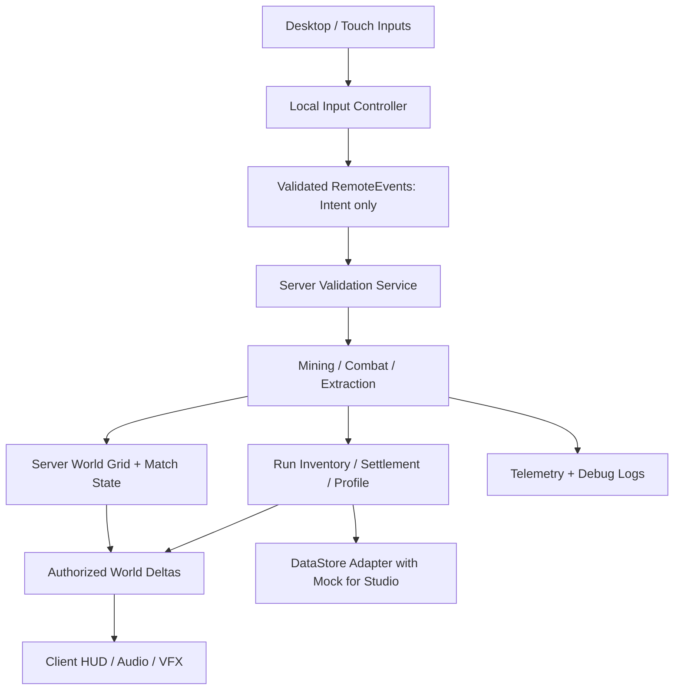

# ANTWARS — TECHNICAL ARCHITECTURE FOR ROBLOX STUDIO

## 1. Technical goal and constraints

Build a **real, server-authoritative, multiplayer** playable vertical slice in Roblox Studio. The spatial data should support deterministic resource placement, cooperative/competitive digging, discovery and collision, while remaining playable on mobile. Protect live data and user-authored Studio assets. If a preferred technique proves impractical, document the simpler measured replacement instead of generating thousands of laggy Parts.

**Official references (recheck when implementing):**
- Studio MCP: https://create.roblox.com/docs/studio/mcp
- Roblox scripting remotes: https://create.roblox.com/docs/scripting/events/remote
- Client-server security: https://create.roblox.com/docs/scripting/security/client-server-boundary
- Data stores: https://create.roblox.com/docs/cloud-services/data-stores
- Terrain API: https://create.roblox.com/docs/reference/engine/classes/Terrain
- Testing modes: https://create.roblox.com/docs/studio/testing-modes
- `StudioTestService`: https://create.roblox.com/docs/reference/engine/classes/StudioTestService
- Performance optimization: https://create.roblox.com/docs/performance-optimization

Do not assume an undocumented engine method exists. Consult Studio MCP `http_get` / official docs if unsure.

## 2. Architectural layers



**Server owns:** match phase, map seed, hidden ore type, mined flags, rewards, run inventory, stamina/health decisions, tool stats, authoritative damage, extraction validity, settlement, durable save state.

**Client owns only:** local input, camera, HUD rendering, optional non-authoritative predicted mine animation, local effects, menu state. Client cannot award itself loot or choose enemy damage.

## 3. Modules and responsibilities

### Shared
- `Config`: min/max players, round timing, grid size, hit cooldowns, resource tables, ore rarity weights, extraction balance, visuals and debug flags; one canonical source.
- `Types`: typed tables for `Cell`, `PlayerRun`, `Profile`, `Round`, `MiningResult`.
- `GridMath`: grid index/world position conversions; coordinate bounds, neighbor lookup, deterministic hashing. Unit-tested.
- `ItemDefinitions`: ore/item rarity, yield, tool properties, backpack unit volume, UI display names/colors.
- `RemoteNames`: names/contract version shared with clients. No dynamic network path from client.

### Server
- `Bootstrap`: ensures containers/remotes exist; constructs services in dependency order; cleans up after hot reload where possible; logs build version.
- `MatchService`: lobby, countdown, match lifecycle, alive/extracted/dead player states, end-of-round, reward settlement once, queue re-entry.
  **Exactly-one-champion invariant:** Last active living non-extracted player wins unless solo debug; on timeout/no active contestants rank by PvP defeats, then banked+carried ore, then survival time, then unique user ID. Champion result is computed once on server and sent to every client. Extracted players bank loot but forfeit championship.

- `WorldGridService`: seeded hidden material map, diggable occupied states, spawn pockets, traversable and protected cells, rendering or Terrain mutations, broadcast world deltas.
- `MiningService`: tool equipped, per-player dig rate, camera/raycast/target validation, cell health, atomic cell destruction, ore reward and inventory capacity.
- `InventoryService`: runs and durable inventory, only server modifications, capacity, loot bag claims, overflow feedback.
- `CombatService`: attack request, server verification of proximity and target, damage, death callback, death bag and salvage settlement.
- `ExtractionService`: valid proximity, extraction unlocking, channel timers, interrupt conditions, successful run settlement, prevents repeated claims.
- `PersistenceService`: versioned DataStore schema, mock fallback, retry/error boundaries, atomic updates, no studio-to-live access by default.
- `ValidationService`: reusable type checks, position bounds, cooldown/rate limits, non-finite inputs, state/ownership checks.
- `TelemetryService`: events throttled/sampled where needed, developer/debug logs, in-memory counters if analytics not enabled.

### Client
- `InputController`: desktop, touch and optional gamepad binds using Roblox-supported input APIs.
- `MiningController`: selects target, draws mining reticle/progress/VFX, sends intent and reconciles confirmed result.
- `CombatController`: input and non-authoritative swing visual, waits for authoritative hit feedback.
- `HudController`: text/icons/bars, responsive sizing, hints and result states, reacts to server snapshots/deltas.
- `EffectsController`: pooled particles/sound, screen feedback limits, accessible settings.
- `CameraController`: shoulder 3rd-person default with anti-clipping when tunneling, gentle optional first-person later. Don't force motion sickness.

## 4. World representation and renderer choice

### 4.1 Logical voxel representation
Use a server-owned **logical cell map** keyed by `(x,y,z)` and `roundSeed`. For the prototype, size about `48 x 48 x 6`, `cellSize = 6` studs; horizontal X/Z tunnels are first-class and vertical routes initially curated. Cell contains:

```
Cell = {
  materialId: numeric_enum,
  hp: nonnegative_number,
  solid: boolean,
  mineable: boolean,
  protected: boolean,
  revealed: boolean, -- server reveal/exposure state
  dropSeed: integer, -- or lookup derivation from roundSeed + coordinate
  generationVersion: integer
}
```

Store data compactly, not one Roblox Instance per cell. A `BitBuffer`/packed byte array is optional if supported, but do not invent unsupported APIs. Assign seed to server at round start and record for reproducible bug reports.

### 4.2 Candidate rendering approaches, in preference order
**A. Chunked block faces / sparse physics** (preferred if implemented correctly): generate solid geometry only for exposed surfaces (or merge contiguous adjacent faces), update relevant chunk when a cell is broken. Use capped per-frame chunk updates, reuse materials, preallocate/pool where sensible. Make walkable space and barrier collisions consistent.

**B. Roblox Terrain**: for a coarse “diggable earth” prototype, use `Terrain:FillBlock`/supported voxel APIs and remove cells with `Enum.Material.Air`. Terrain is 4-stud voxels, so if choosing Terrain, align logical cell resolution and conversion appropriately; benchmark repeated mutation and network behavior, do not assume Terrain or Part approach is always superior. Terrain is useful for natural caves but resource blocks still need independent hidden server map.

**C. Narrow proof-of-concept with limited visible cells**: acceptable fallback if A/B cannot be completed safely in the current session. Must still be a real traversable destructible tunnel with 2 clients in a bounded test world, not just cosmetic particles.

**DO NOT:** create a permanent individual collidable BasePart for every solid logical cell, replicate every secret ore piece, destroy entire map/rebuild all Parts on every dig, use thousands of unanchored physics blocks, or blindly stream hidden loot values to all clients.

### 4.3 Exposed-face and secret loot rules
For each mined cell:
1. Validate round active and requested coordinates within bounds and adjacent to reachable face.
2. Atomically decrement its HP / transition solid=false only once.
3. Create immediate clearance for character/physics where mined cell was.
4. Update visible geometry only in affected chunk and adjacent boundary chunks.
5. Send essential small deltas to relevant clients (coordinate, exposed visible material, destruction animation), never entire underlying hidden ore table.
6. Credit resource exactly once, based on server map, if appropriate.
7. Allow two competing requests without two rewards, two drop bags or inconsistent tunnel state.

The biggest risk is implementing “anti-Xray” superficially: even if ore is not visible, replicating all hidden ore properties into the client allows exploiters to inspect them. Only client-visible, discovered material should be sent.

### 4.4 Map generation specifics
- Seeded PRNG with stable hash per `(seed, x, y, z)` for material distribution; use configurable tier weights by band. Seed and algorithm version recorded.
- Outer two or more cells reinforced/indestructible.
- Safe spawn pockets carved before final geometry generation. Ensure first diggable wall appears nearby.
- Select two safe extraction chambers and verify their reachability under diggable rules. Reachability can be estimated with grid breadth-first search treating mineable cells as diggable-cost edges; prohibit impossible solid/boundary.
- Add limited prefabricated tunnel openings and occasional niches without pre-revealing opponents.
- Initial ore near spawn should ensure reward without guaranteeing rare finds. Rare ore by seeded probability, never loot when mining a protected border.
- Chunk rendering updates must be bounded: e.g. queue dirty chunks and process a maximum per frame with enough responsiveness to avoid phantom collision. Tune measured values.

## 5. Mining network and server contract

### `MineRequest` client → server
Payload example `{ v=1, cell={x=INTEGER,y=INTEGER,z=INTEGER}, toolId="StarterPick" }`. The client should NOT send `oreType`, `dropAmount`, `toolDamage`, target Instance path or a ready-made reward.

Server validation checklist:
1. Payload table/schema known, no unknown huge nested payloads.
2. Coordinates are finite numbers and integers within bounds.
3. Player exists, alive, within active round and not extracting/dead.
4. Equipped item is known and owned/authorized.
5. Cell is solid, mineable, not protected and adjacent to a currently valid reachable surface. Validate actual world distance (e.g. 14 studs) and unobstructed ray or voxel adjacency.
6. Per-player click/hold rate respects tool stats. Bound request frequency before expensive operations.
7. Reduce HP using server-defined pickaxe strength; atomically finish cell; if two requests race, only one finishes cell.
8. Award loot only once if capacity permits, otherwise explicit overflow handling.
9. Emit result/delta + visual feedback; no hidden info leakage.

### `MineResult` server → client
Success/denial code, `cell`, `hpRemaining`, `destroyed`, summarized awarded item/qty if player has right to see, `serverTime` optional. Failure should not leak precise hidden ore.

### Input smoothing
For hold-to-mine, client sends bounded requests. Agent may implement local anticipation crack animation, but server remains authoritative; UI must reconcile denied requests. Anti-macro measures should focus on rate limits, not impossible “perfect detection.”

## 6. Combat network and server contract

### `CombatRequest` client → server
Payload intent: attack sequence ID and (optional) aim direction vector or selected target within range, **never** damage amount. Rate-limit and validate schema.

Server validation:
- round ACTIVE, both players alive, PvP protection expired, legitimate equipped melee tool;
- attacker cooldown by authoritative clock, not client's timestamp;
- origin/target distance, server-known character positions, sensible facing/LOS; hitboxes should not allow hit through solid cell walls;
- cap single hit damage and disallow duplicate sequence replay;
- apply damage once; on death transition player to DEAD once, invoke inventory loss / bag spawn settlement exactly once.

**Caveat:** Roblox character movement uses platform networking with client ownership by default in many experiences. Do not promise absolute cheat elimination; validate plausible positions and interactions on server, and check current supported server-authority options in official docs before changing movement replication architecture.

## 7. Extraction state machine

`LOCKED` → `AVAILABLE` → `CHANNELING` → either `INTERRUPTED` or `COMPLETE`.

Required authoritative checks: phase, player alive/present, unlock time reached, entrance proximity, channel duration elapsed, uninterrupted status, no duplicate transaction. Client UI displays hold/progress but cannot commit extraction. Server issues a one-time result with converted inventory, stats and lobby routing. Track per-player `settledRunId` to prevent double-credit if a player dies while channeling or spams the network.

## 8. Loot bags / death and idempotency

- On confirmed death calculate integer quantities from unbanked loot. Suggested: `salvage = floor(amount*0.40)`, `drop = amount-salvage` by item; never duplicate/negate totals.
- Spawn at most one server-controlled bag per death. Ownership of claim is server-defined (any survivor, configurable) with time-to-live to avoid clutter.
- Claim via `ProximityPrompt` or validated request; require real range and atomically set `claimed=true` before adding items.
- If inventory full, either partial transfer or no claim with clear feedback; don't discard an entire rare bag unexpectedly.
- Client must not decide claim amount or change bag contents.
- End-of-round settlement is a separate idempotent operation; store `roundId`/status and clear run inventory once.

## 9. Persistence plan

Use `DataStoreService` for durable values only. Studio prototype defaults to an in-memory mocked store, with **documented toggle** for dedicated unpublished/private test universe. Do NOT turn on API Services against production data without permission.

Example schema:

```
Profile = {
  schemaVersion = 1,
  salvage = 0,
  pickaxeTier = 1,
  backpackTier = 1,
  cosmetics = {},
  lifetime = { runs=0, extracted=0, ore=0, defeats=0 },
  tutorial = { firstMine=false, firstExtract=false },
  lastUpdated = 0,
}
```

Recommended:
- Default/migration functions for unknown/missing fields.
- Server-side update of currency and upgrades with careful conflict handling.
- `UpdateAsync` where atomicity matters, `pcall`, retries with capped exponential backoff for transient errors, throttle and avoid writes on every mined block.
- Join/leave and autosave; gracefully handle shutdown via `BindToClose` where suitable.
- Profile-session locking strategy if persistence grows; for MVP at least avoid concurrent writes/clobbering.
- No profile corruption or free infinite currency if saves fail. Pending rewards may need explicit safe fallback; do not invent a guarantee of durability during outage.

## 10. UI rendering and responsiveness

Implement Studio-native `ScreenGui`/Frames/TextLabels/ImageLabels/Buttons with scale-based sizing, constraints, safe areas and anchor points; canvas group/UIScale if supported. Avoid relying on nonexistent uploaded GUI images. Native placeholders with icons/text/colors are acceptable. Prefer Gotham or current available Roblox UI font. Game text is English with localization keys.

HUD state should be driven by server snapshots/deltas (`ClientState`) with client-only ephemeral cosmetics (crosshair animation). Camera zoom/intersection must permit hitting blocks in narrow tunnels. On mobile verify 16:9 and tall phone resolutions and UI does not cover actions.

## 11. Audio, FX, lighting performance

- Native particle emitter bursts and brief highlights on verified hits, not hundreds of persistent emitters.
- Audio sound groups, 3D spatial positioning for remote digging, attenuation radius and muffling approximated without overpromising physically accurate wall occlusion.
- Limit simultaneous mining impacts and particles; pool where practical.
- Use material color/shape and SurfaceAppearance/decals judiciously; no unauthorized copyrighted assets.
- Exposure/ambient: dark but readable; green extraction must visually pop from ore; red PvP feedback distinct from copper orange.

## 12. Testing matrix

### Unit-like tests (where a test runner is available)
- GridMath: `cellToWorld` inverse, negative/infinite values rejected, out-of-bounds handling.
- Generation: same seed yields same ore and map; opposite seeds plausibly differ; valid spawn cells; extraction reachable.
- Economy: default/upgrade, integer conversion, no negative wallet, backpack cap, round loss totals conserved.
- Idempotency: concurrent mining same cell → exactly one resource award; repeated bag claim → once; repeated extract → once.

### Studio tests
- Solo smoke: spawn, mine 3 blocks, ore UI correct, extraction timer, bank, requeue.
- Two-client Studio multiplayer: different pockets; digging synced; neither sees hidden ore or opponents through walls via authored UI; meet; fight; casualty; loot bag; extraction.
- Four-client: simultaneous mining, rapid join/leave, one disconnect while extracting, inventory full, death at exact expiry.
- Mobile emulator: touch mine/attack/interact and camera; HUD safe area/readability.
- Security negative tests: forged ore qty, out-of-range coordinates, invalid types, spam, long tables, repeated extraction, attacking through wall, out-of-phase operations.
- Performance: measure average/worst observed FPS, server Script Activity, instance count, peak memory, time per mining mutation; record real values or `NOT MEASURED`.
- MCP test tools: use available `get_studio_state`, `start_stop_play`, `get_console_output`, `screen_capture`, subagent playtest (if present). Note MCP single-play may not validate multiplayer: use Studio multi-client Testing Modes or `StudioTestService` where supported, and mark unverified if unavailable.

## 13. Common failure conditions and specific remediation

| Failure | Likely cause | Fix direction |
|---|---|---|
| Only particles when mining | World collision not modified | Mutate authoritative cell and relevant colliders |
| Dig seen by one player only | Client-local world changes | Server replicates verified world delta |
| Ore duplicated | Race condition on cell or bag | Atomic claimed/mined flag before reward |
| Client sees all rare blocks | Hidden map replicated | Server-only material seed, reveal only exposed surfaces |
| Game lags with 3 players | Too many Parts/physics/remotes | Exposed chunks, merge geometry, throttle FX/deltas |
| Attack works through walls | Insufficient LOS verification | Server raycast / solid grid intersection |
| Player stuck in newly dug tunnel | Size mismatch or delayed collider update | Consistent grid-to-physics, 2-cell walk height |
| Camera inside rock | Narrow corridors / bad camera collision | Tune camera zoom/collision settings and tunnel dimensions |
| Mobile mine impossible | Input bound to mouse only | Explicit touch UI / ContextActionService |
| Save corrupt after studio test | Live store connected in development | Mock adapter + separate test universe |
| Agent says “done” but no game | Didn't run Studio tools/tests | Require MCP objects + proof via console/screenshot |

## 14. Release boundary

**MVP means testable by a small private group; it does not imply commercial/public readiness.** Before any public release: inspect current Roblox content maturity and policy requirements, asset/IP licenses, filtering/chat exposure, accessibility, logging/data handling, crash resilience, device test matrix and exploit risks. Do not enable monetization until fair play and gameplay retention are tested.
